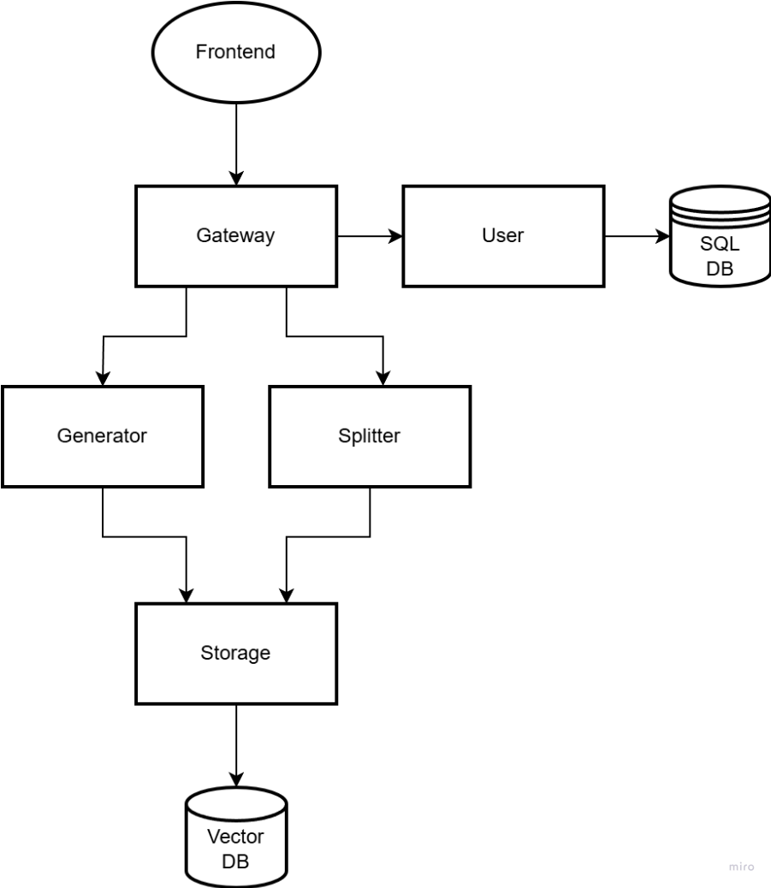
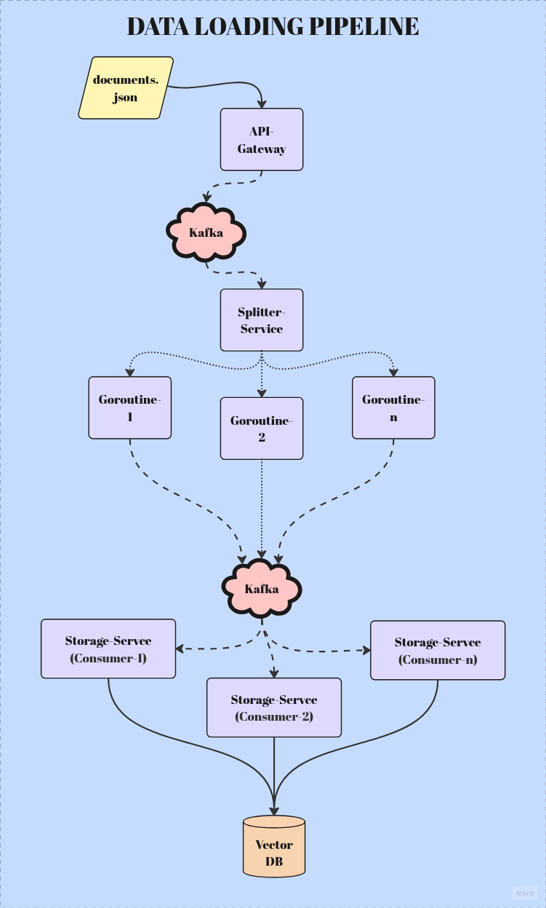
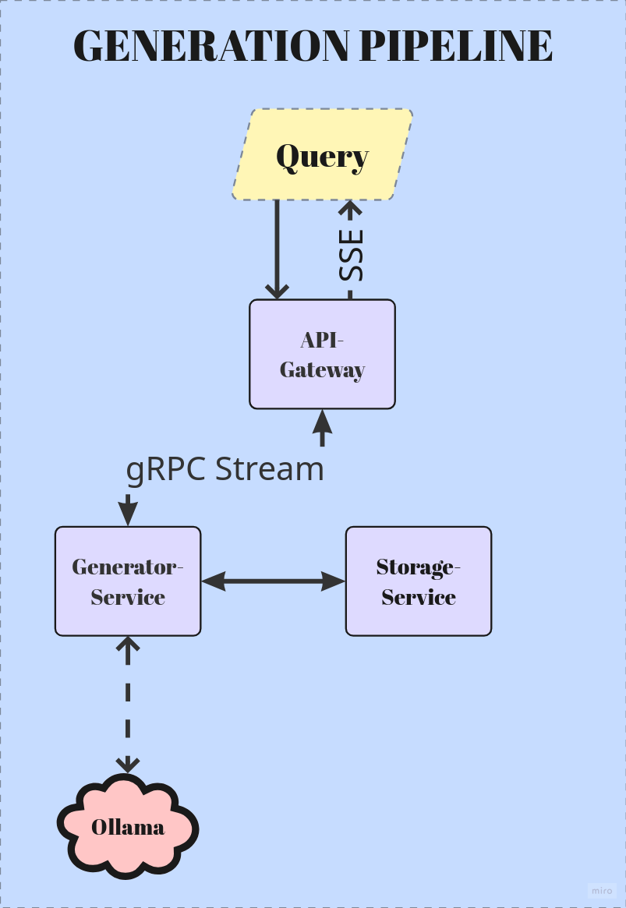

# RAGO — распределённая RAG-платформа на Go

RAGO — распределённая платформа Retrieval-Augmented Generation. Документы пользователей проходят асинхронный конвейер индексации (Apache Kafka, Qdrant), генерация ответов выполняется локальной LLM (Ollama) с потоковой передачей токенов через SSE. Наблюдаемость обеспечивают Prometheus, Grafana, Loki и Promtail.

> Проект носит учебный характер и не готов к использованию в продакшене.

## Возможности

- Загрузка и индексация документов в векторное хранилище (Qdrant)
- Генерация ответов с использованием LLM (Ollama) в режиме потоковой передачи токенов
- Персональные коллекции документов, аутентификация по JWT, авторизация по API-ключам
- Асинхронная обработка больших объёмов документов через Apache Kafka
- Мониторинг метрик (Prometheus + Grafana) и централизованный сбор логов (Loki + Promtail)

## Структура репозитория

Репозиторий организован как монорепозиторий Go с единственным корневым модулем `github.com/child6yo/rago`.

```
.
├── api-gateway/          # Единая точка входа: REST API, SSE, gRPC-клиенты, продюсер Kafka
├── services/
│   ├── user/             # Пользователи, JWT, API-ключи, коллекции (PostgreSQL)
│   ├── splitter/         # Разделение массивов документов (Kafka, пул воркеров)
│   ├── storage/          # Эмбеддинги и векторное хранилище (Qdrant, Kafka, Ollama)
│   └── generator/        # Контекстно-зависимая генерация (Ollama, langchaingo)
├── proto/                # gRPC-контракты: user, storage, generator
├── client/               # Статический веб-клиент (nginx)
├── deploy/               # Dockerfile'ы всех сервисов
├── utils/                # Конфигурации Prometheus, Grafana, Loki, Promtail
├── scripts/              # Скрипты инициализации Kafka и Ollama
├── examples/             # Пример загрузки данных (Python)
├── docker-compose.yaml   # Полная инфраструктура проекта
├── go.mod                # Корневой Go-модуль
└── Makefile
```

## Быстрый старт

1. Скопируйте `.env.example` в `.env` и при необходимости измените значения переменных.
2. Запустите стек:

   ```
   make up
   ```

   или напрямую:

   ```
   docker compose up -d --build
   ```

3. Дождитесь инициализации сервисов (3–10 минут). Основное время занимает загрузка языковых моделей Ollama при первом запуске.

После запуска:

- Web API доступен по адресу `localhost:8080` — [API Reference](api-gateway/docs/API_REF.md)
- Тестовый веб-интерфейс генерации доступен по адресу `localhost:80`
- Grafana доступна по адресу `localhost:3000` (admin/admin)

Для базовой проверки работоспособности:

1. Зарегистрируйте пользователя.
2. Создайте API-ключ.
3. Загрузите документы [скриптом](examples/load_data/load_data.py), используя API-ключ.

## Архитектура



### Компоненты

| Компонент          | Назначение                                          | Технологии                          |
|--------------------|-----------------------------------------------------|-------------------------------------|
| API Gateway        | Единая точка входа, маршрутизация REST-запросов, SSE-трансляция потока генерации | Gin, gRPC, Kafka, Prometheus |
| User Service       | Регистрация и аутентификация (JWT), управление API-ключами и коллекциями | gRPC, PostgreSQL  |
| Splitter Service   | Разделение массивов документов на отдельные записи  | Kafka, пул горутин                  |
| Storage Service    | Генерация эмбеддингов, индексация и поиск в векторном хранилище | Qdrant, Ollama, Kafka |
| Generator Service  | Формирование промпта из найденного контекста и потоковая генерация | Ollama, langchaingo, gRPC |

Внутреннее взаимодействие сервисов выполняется по gRPC (синхронные вызовы и потоки) и через Kafka (асинхронная обработка документов). Межсервисные контракты описаны в каталоге `proto/`.

### Пайплайн загрузки документов



1. Клиент отправляет массив документов в API Gateway по REST.
2. API Gateway валидирует запрос и буферизует данные в топике `raw-docs`.
3. Splitter Service потребляет сообщения из `raw-docs`, пул горутин параллельно разделяет массив на отдельные документы и публикует их в `document-topic`.
4. Storage Service генерирует эмбеддинги (Ollama) и сохраняет векторы в Qdrant в коллекции пользователя.

### Пайплайн генерации



1. Клиент отправляет запрос в API Gateway по REST.
2. Generator Service выполняет векторный поиск по коллекции пользователя через Storage Service.
3. Generator Service формирует промпт из найденного контекста и запускает генерацию в Ollama (через langchaingo).
4. Токены передаются по gRPC-потоку в API Gateway, который транслирует их клиенту через SSE.

## Мониторинг

- Prometheus (`localhost:9090`) собирает метрики API Gateway (`/metrics`).
- Grafana (`localhost:3000`) используется для визуализации; источник данных provisioned автоматически.
- Promtail собирает логи контейнеров и передаёт их в Loki.

## Документация

- [API Reference](api-gateway/docs/API_REF.md)

## Лицензия

Проект распространяется по лицензии, описанной в [LICENSE.md](LICENSE.md).
