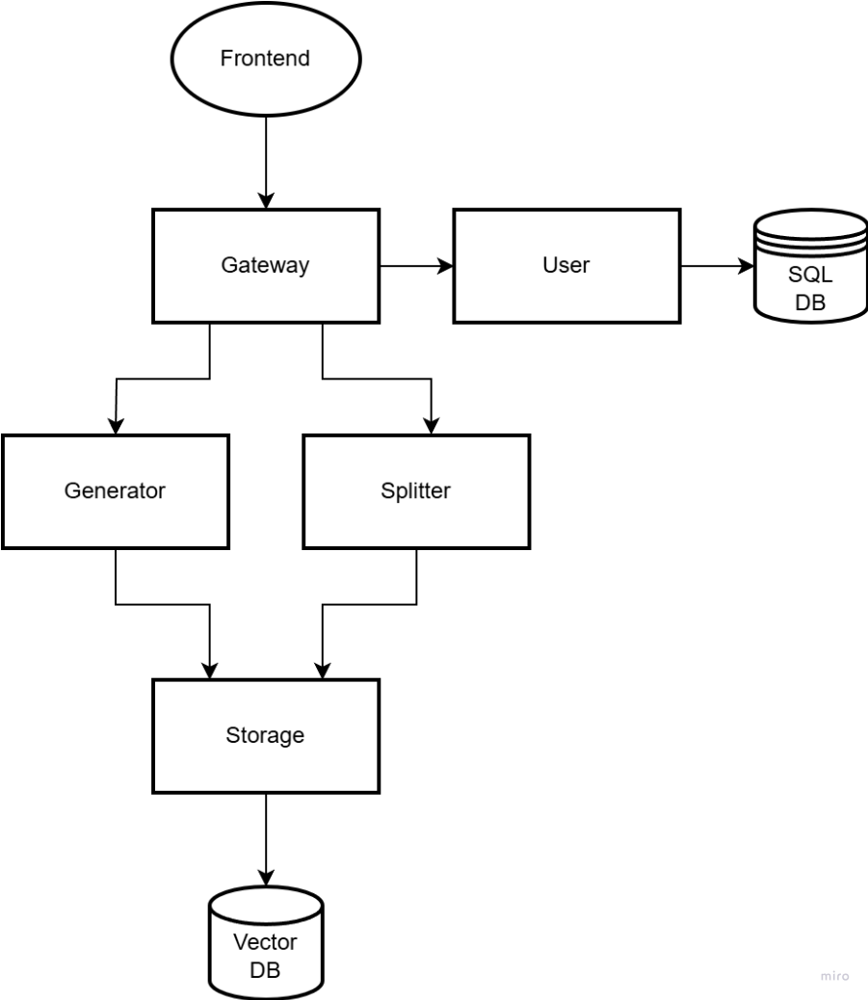
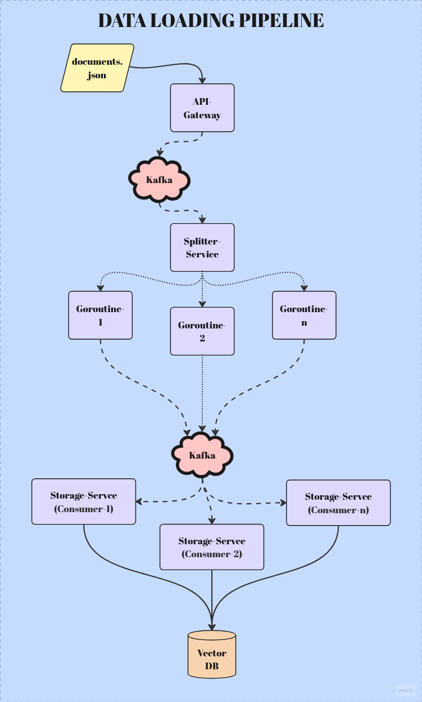
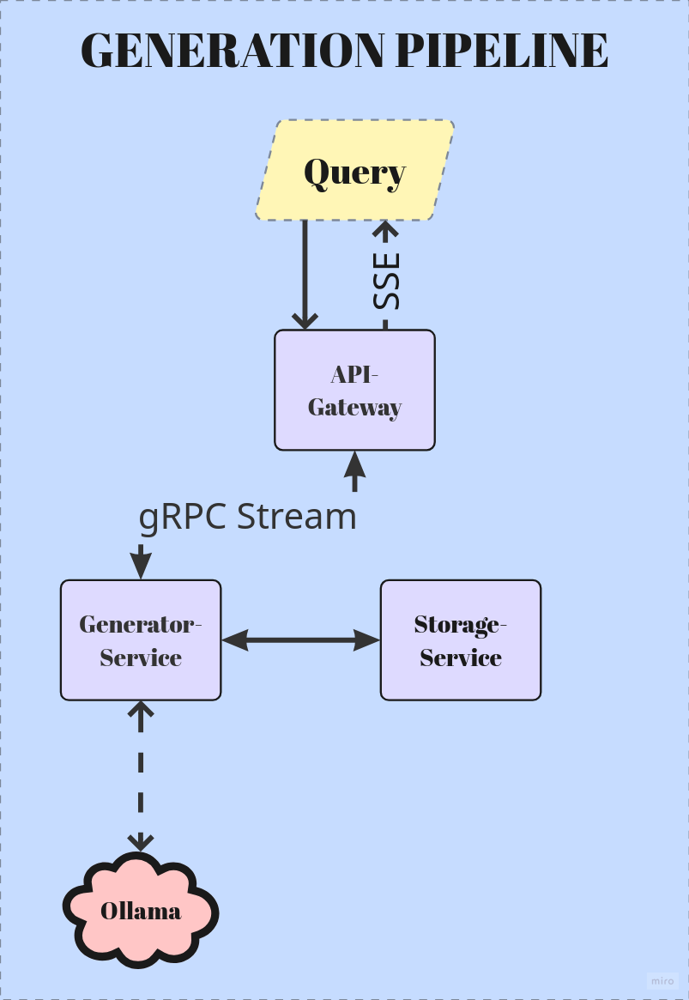

# RAGO — Distributed RAG Platform in Go

RAGO is a distributed Retrieval-Augmented Generation platform. User documents go through an asynchronous ingestion pipeline (Apache Kafka, Qdrant), while answer generation runs on a local LLM (Ollama) with token-by-token streaming over SSE. Observability is provided by Prometheus, Grafana, Loki, and Promtail.

> This is an educational project and is not production-ready.

## Features

- Document upload and indexing into a vector store (Qdrant)
- Answer generation with an LLM (Ollama) using token-by-token streaming
- Personal document collections, JWT authentication, API key authorization
- Asynchronous processing of large document volumes via Apache Kafka
- Metrics monitoring (Prometheus + Grafana) and centralized log collection (Loki + Promtail)

## Repository Layout

The repository is organized as a Go monorepo with a single root module `github.com/child6yo/rago`.

```
.
├── api-gateway/          # Single entry point: REST API, SSE, gRPC clients, Kafka producer
├── services/
│   ├── user/             # Users, JWT, API keys, collections (PostgreSQL)
│   ├── splitter/         # Document array splitting (Kafka, worker pool)
│   ├── storage/          # Embeddings and vector storage (Qdrant, Kafka, Ollama)
│   └── generator/        # Context-aware generation (Ollama, langchaingo)
├── proto/                # gRPC contracts: user, storage, generator
├── client/               # Static web client (nginx)
├── deploy/               # Dockerfiles for all services
├── utils/                # Prometheus, Grafana, Loki, Promtail configurations
├── scripts/              # Kafka and Ollama initialization scripts
├── examples/             # Data upload example (Python)
├── docker-compose.yaml   # Full project infrastructure
├── go.mod                # Root Go module
└── Makefile
```

## Quick Start

1. Copy `.env.example` to `.env` and adjust the variables if needed.
2. Start the stack:

   ```
   make up
   ```

   or directly:

   ```
   docker compose up -d --build
   ```

3. Wait for the services to initialize (3–10 minutes). Most of the time is spent downloading Ollama language models on first start.

Once running:

- The Web API is available at `localhost:8080` — [API Reference](api-gateway/docs/API_REF.md)
- A basic web UI for generation is available at `localhost:80`
- Grafana is available at `localhost:3000` (admin/admin)

To verify basic functionality:

1. Register a user.
2. Create an API key.
3. Upload documents with the [script](examples/load_data/load_data.py) using the API key.

## Architecture



### Components

| Component         | Purpose                                                                | Technologies                |
|-------------------|------------------------------------------------------------------------|-----------------------------|
| API Gateway       | Single entry point, REST routing, SSE relay of the generation stream   | Gin, gRPC, Kafka, Prometheus |
| User Service      | Registration and authentication (JWT), API key and collection management | gRPC, PostgreSQL           |
| Splitter Service  | Splitting document arrays into individual records                      | Kafka, goroutine pool       |
| Storage Service   | Embedding generation, indexing and search in the vector store          | Qdrant, Ollama, Kafka       |
| Generator Service | Prompt construction from retrieved context and streaming generation    | Ollama, langchaingo, gRPC   |

Services communicate over gRPC (synchronous calls and streams) and Kafka (asynchronous document processing). Inter-service contracts are defined in the `proto/` directory.

### Document Ingestion Pipeline



1. The client sends a document array to the API Gateway over REST.
2. The API Gateway validates the request and buffers the data in the `raw-docs` topic.
3. The Splitter Service consumes from `raw-docs`; a goroutine pool splits the array into individual documents in parallel and publishes them to `document-topic`.
4. The Storage Service generates embeddings (Ollama) and stores the vectors in Qdrant in the user's collection.

### Generation Pipeline



1. The client sends a request to the API Gateway over REST.
2. The Generator Service performs a vector search over the user's collection via the Storage Service.
3. The Generator Service builds a prompt from the retrieved context and starts generation in Ollama (via langchaingo).
4. Tokens are streamed over gRPC to the API Gateway, which relays them to the client via SSE.

## Monitoring

- Prometheus (`localhost:9090`) scrapes API Gateway metrics (`/metrics`).
- Grafana (`localhost:3000`) is used for visualization; the data source is provisioned automatically.
- Promtail collects container logs and ships them to Loki.

## Documentation

- [API Reference](api-gateway/docs/API_REF.md)

## License

The project is licensed under the terms described in [LICENSE.md](LICENSE.md).
